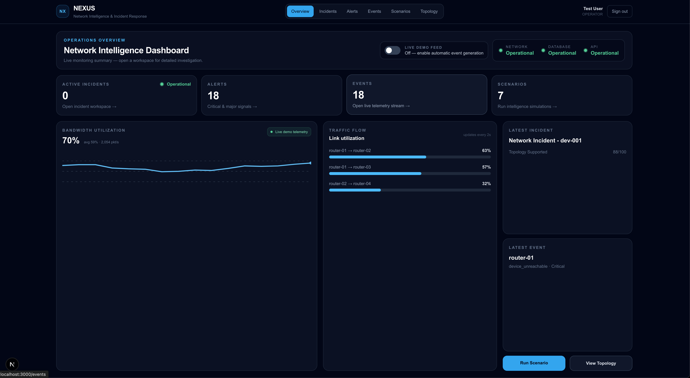
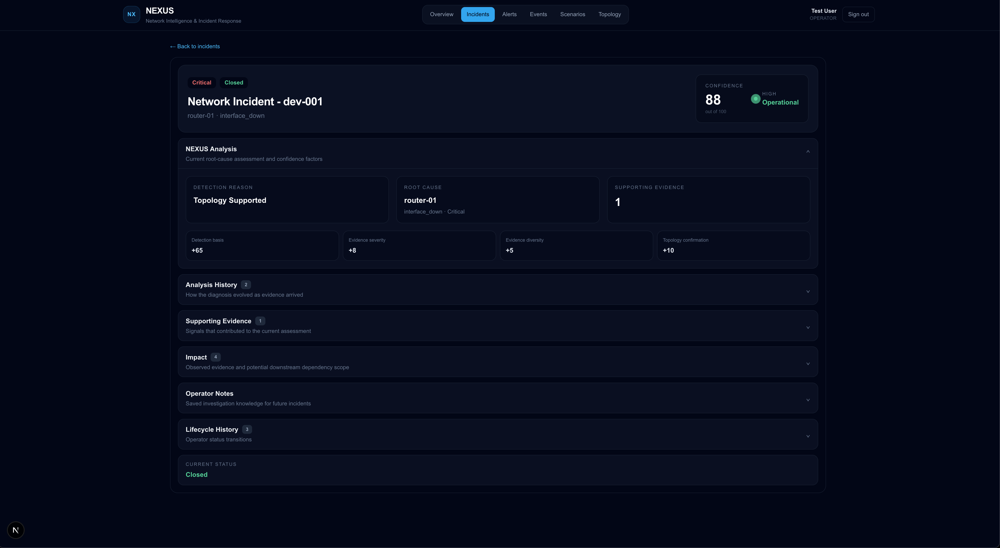
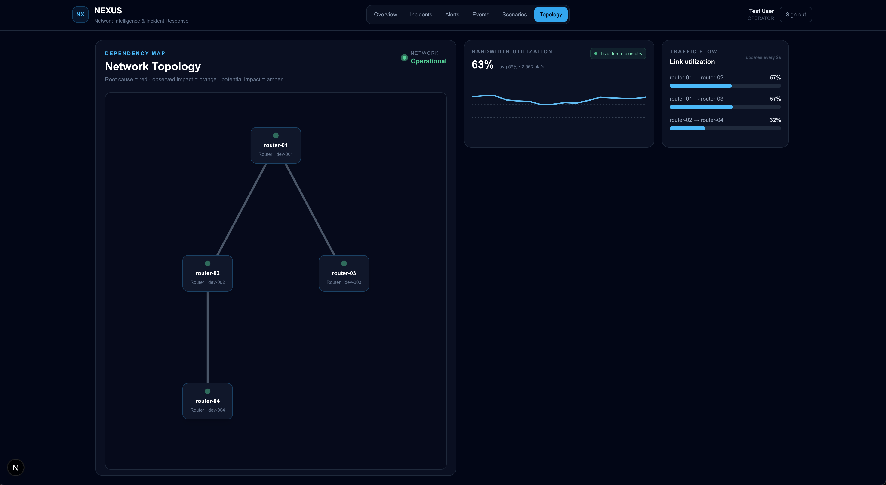
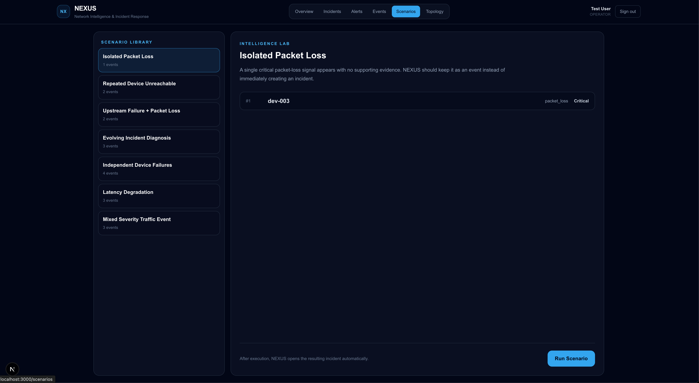
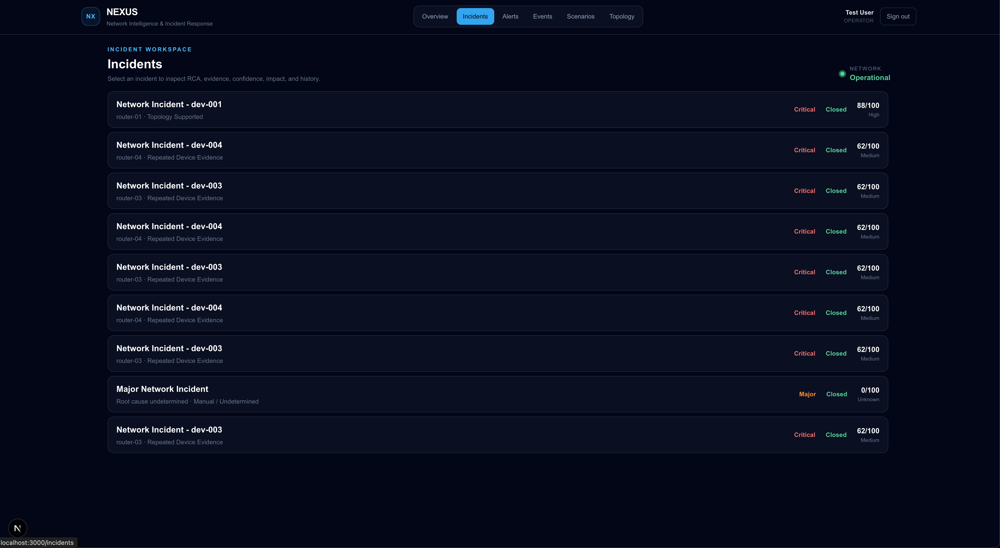
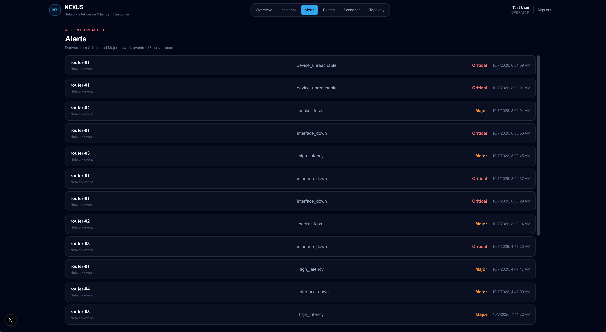
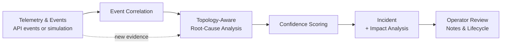
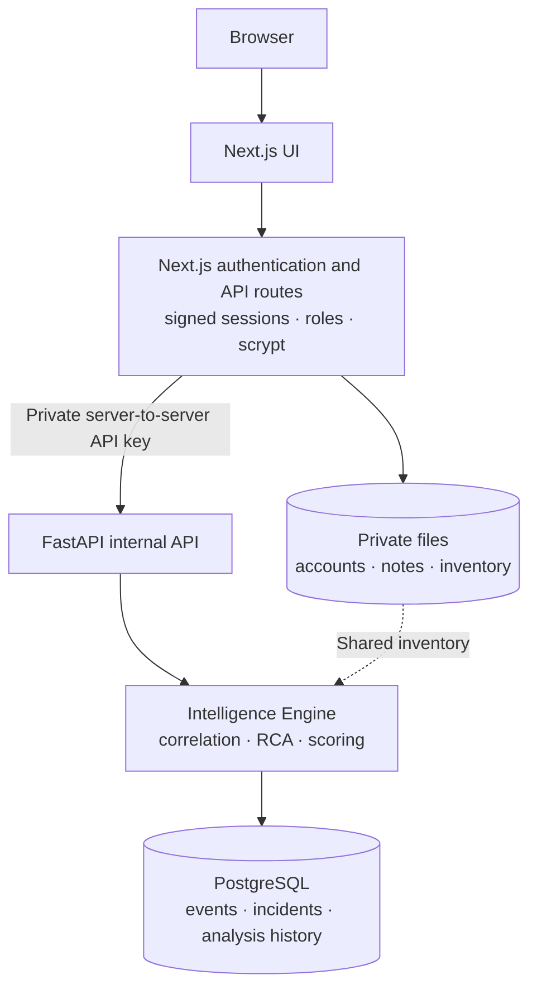

<div align="center">

# NEXUS

### Network Intelligence & Incident Response Platform

**Correlate events. Find the root cause. Know what breaks next.**

[](https://nextjs.org/)
[](https://react.dev/)
[](https://www.typescriptlang.org/)
[](https://tailwindcss.com/)
[](https://fastapi.tiangolo.com/)
[](https://www.python.org/)
[](https://www.postgresql.org/)
[](https://www.docker.com/)

<br />



</div>

---

## Overview

When a network misbehaves, operators don't get one clean alert. They get a flood of them: interface flaps, latency spikes, unreachable devices, packet loss. Most of those alerts are symptoms of a single underlying failure, and a NOC analyst has to work out which one while the clock is running.

**NEXUS** is a network intelligence and incident response platform built to shorten that gap. It ingests network events through an authenticated API, correlates related events into incidents, uses the network's **topology** to identify the most likely root cause, and attaches a transparent **confidence score** that explains *why* it reached that conclusion. As new evidence arrives, the diagnosis updates and the full history of how it changed is preserved.

> NEXUS doesn't just tell you something is wrong. It shows you what is probably causing it, how sure it is, what else may be affected, and how that picture changed over time.

---

## Key Features

| | Feature | What it does |
|---|---|---|
| 🔗 | **Event correlation** | Groups related network events into a single incident instead of flooding operators with isolated alerts. |
| 🧭 | **Topology-aware root-cause analysis** | Uses device dependencies to distinguish the failing upstream device from the downstream devices merely reporting symptoms. |
| 📊 | **Explainable confidence scoring** | Every diagnosis gets a 0–100 score broken into named factors (detection basis, evidence severity, evidence diversity, topology confirmation), so analysts can see how the number was built. |
| 🕰️ | **Evolving diagnosis** | Root-cause assessments are re-evaluated as new evidence arrives, and each revision is kept in an analysis history. |
| 💥 | **Impact analysis** | Separates *observed* impact from *potential* downstream impact based on dependency scope. |
| 🔄 | **Incident lifecycle tracking** | Operator status transitions are recorded for a complete audit trail. |
| 📝 | **Operator notes** | Investigation knowledge is saved with the incident so it's available for future ones. |
| 🧪 | **Scenario simulation lab** | A library of 9 scripted failure scenarios lets you replay situations (isolated packet loss, repeated unreachable devices, upstream failure with downstream loss, and more) and watch NEXUS reason through them. |
| 📡 | **Live demo telemetry** | Simulated bandwidth and per-link traffic-flow visualizations, with an optional automatic event generation feed. |
| 🔐 | **Secure authentication** | Signed sessions, HttpOnly cookies, scrypt password hashing, and viewer/operator/admin access controls. |

---

## Screenshots

<table>
  <tr>
    <td width="50%">
      <strong>Operations Overview</strong><br />
      
    </td>
    <td width="50%">
      <strong>Incident Analysis & Confidence Scoring</strong><br />
      
    </td>
  </tr>
  <tr>
    <td width="50%">
      <strong>Network Topology & Dependency Map</strong><br />
      
    </td>
    <td width="50%">
      <strong>Scenario Intelligence Lab</strong><br />
      
    </td>
  </tr>
  <tr>
    <td width="50%">
      <strong>Incident Workspace</strong><br />
      
    </td>
    <td width="50%">
      <strong>Alerts & Telemetry Stream</strong><br />
      
    </td>
  </tr>
</table>

---

## How It Works



1. **Ingest.** Network events (`interface_down`, `device_unreachable`, `packet_loss`, `high_latency`) arrive through the event API or scenario simulation, each tagged with a device and severity.
2. **Correlate.** Related events are grouped together rather than treated as independent alerts.
3. **Locate the root cause.** The dependency map is consulted to find which device is the likely origin and which are downstream symptoms.
4. **Score.** A confidence score is assembled from explicit, visible factors. For example, an incident might score `88/100`: detection basis `+65`, evidence severity `+8`, evidence diversity `+5`, topology confirmation `+10`.
5. **Track.** As more evidence arrives, the analysis is revised, and every revision is stored alongside operator notes and status transitions.

### Why explainable scoring?

Black-box "AI says it's the router" output isn't useful during an outage. Operators need to know *what the conclusion rests on*. NEXUS deliberately uses a transparent, rule-based scoring model so every point of confidence can be traced to a specific piece of evidence, and so behavior is deterministic and testable.

---

## Tech Stack

### Frontend
| Technology | Role |
|---|---|
| **Next.js** | App framework, routing, and server-side rendering |
| **React** | Component-based UI for dashboards, incident workspaces, and topology views |
| **TypeScript** | End-to-end type safety across components and API contracts |
| **Tailwind CSS** | Utility-first styling for a responsive, consistent dark operations-console UI |

### Backend
| Technology | Role |
|---|---|
| **FastAPI** | High-performance async REST API layer |
| **Python** | Core language for correlation, root-cause, and scoring logic |
| **REST + JSON** | Clean, documented API communication between frontend and backend |

### Data
| Technology | Role |
|---|---|
| **PostgreSQL** | Relational storage for device identities, events, incidents, analysis history, and lifecycle transitions |
| **Private JSON files** | Persistent accounts, operator notes, and shared inventory; stored in application data volumes in Docker |
| **Psycopg** | PostgreSQL driver for direct, explicit database access |

### Security
| Technology | Role |
|---|---|
| **Session-based auth** | Signed session tokens delivered via **HttpOnly cookies** |
| **scrypt** | Memory-hard password hashing |

### Quality & Testing
| Technology | Role |
|---|---|
| **Pytest** | Backend unit and logic tests (correlation, RCA, scoring) |
| **Vitest** | Frontend and unit tests |

### DevOps & Tooling
| Technology | Role |
|---|---|
| **Docker / Docker Compose** | One container running Next.js, FastAPI, and PostgreSQL, with persistent named volumes |
| **Git & GitHub** | Version control and collaboration |
| **VS Code & IntelliJ IDEA** | Development environments |

### Custom Network Intelligence Logic
Built from scratch for this project, not pulled from a library:
- Event correlation engine
- Topology-aware root-cause analysis
- Confidence scoring with itemized factors
- Incident lifecycle tracking
- Dependency mapping and impact scoping

---

## Architecture



Browser requests use the frontend's authenticated `/backend` proxy. The backend requires a private API key that stays on the server. Docker packages the frontend, backend, and database into one container; only the frontend's port is published on your computer's loopback interface.

---

## Security

Data APIs require authentication. Viewers can read, operators can run scenarios and update incidents, and administrators can edit inventory. Signup creates operator accounts; administrator access requires an owner command. Sessions use private persistent signing keys, and logout, password changes, and role changes revoke previous sessions. Requests also have origin checks, input limits, and rate limits.

Online password recovery is disabled until verified email delivery exists; use the owner command below. See [SECURITY.md](SECURITY.md) for access boundaries, external HTTPS configuration, and dependency-audit findings, including the remaining development-only dependency advisory.

## Reference Network

The demo now includes 20 devices spanning a WAN gateway, edge router, firewall, L3 core, DMZ, server racks, office access, wireless clients, VPN gateway, and an independent management network. The 20 assets are connected by 18 directed dependencies across 8 zones. Arrows point from upstream services to dependent devices. Inventory edits feed both the topology screen and backend correlation. This is a logical dependency model with simulated telemetry; it does not configure or emulate physical routers, routing protocols, firewall policies, or high-availability failover. See [the topology design and setup guide](docs/network-topology.md) for addressing, dependency semantics, compatibility, and local setup.

## Getting Started

### Prerequisites

- [Docker](https://www.docker.com/) and Docker Compose  
  *or*, to run services individually: Node.js 22+ (24 tested), Python 3.11+, and PostgreSQL

### Run everything with Docker (one container)

Install and start Docker Desktop (Linux containers on Windows), or Docker Engine with the Compose plugin. For a new checkout:

```sh
git clone https://github.com/lsequx/Nexus.git
cd Nexus
docker compose up --build -d --wait
```

Open **http://localhost:3000**, create an operator account with a 12–128 character password, and sign in. One container runs PostgreSQL 17, FastAPI, and a production Next.js frontend. No local Python, Node.js, database setup, or `.env` file is needed. The first build needs internet access to download dependencies and Google Fonts.

To edit **Admin → Network Inventory**, promote your registered account from your own terminal, then sign out and sign in again:

```sh
docker compose exec --user nexus nexus /opt/venv/bin/python /app/docker/manage-user.py promote-admin your-email@example.com
```

For a forgotten password, run the following command; it prompts for a new password without echoing it:

```sh
docker compose exec --user nexus nexus /opt/venv/bin/python /app/docker/manage-user.py reset-password your-email@example.com
```

### Updates and everyday Docker commands

Run these from the repository root. Preserve any local edits before pulling:

```sh
# Update the checkout and rebuild
git pull --ff-only origin main
docker compose up --build -d --wait

# Check status or follow logs
docker compose ps
docker compose logs -f nexus

# Stop while retaining stored data
docker compose down

# Start again using the existing image
docker compose up -d --wait
```

The `nexus-db` and `nexus-app` named volumes retain database records, accounts, notes, inventory, and private credentials across container recreation. **`docker compose down -v` deletes both volumes and their data.** After upgrading from the earlier authentication implementation, sign in again; existing accounts are retained.

If port 3000 is occupied, put `NEXUS_PORT=3100` in a repository-root `.env` file, then use the same startup command and open **http://localhost:3100**. The bundled database does not publish port 5432 or automatically import an existing standalone database. See [Docker setup and operation](docs/docker.md) for migration guidance, backups, database access, and troubleshooting. Backups must include both the database and application files.

### Local development (without Docker)

These commands use a POSIX shell. On Windows, activate the virtual environment with `.venv\Scripts\activate` and set environment variables using your shell's syntax.

Prepare a local PostgreSQL database named `nexus` and a role with access to it. From the repository root, initialize the schema using your own local connection details:

```sh
export DATABASE_URL="postgresql://YOUR_LOCAL_USER@127.0.0.1:5432/nexus"
psql "$DATABASE_URL" -v ON_ERROR_STOP=1 -f backend/schema.sql

cd backend
python -m venv .venv
source .venv/bin/activate
pip install -r requirements.txt
uvicorn main:app --reload --host 127.0.0.1 --port 8000
```

In a second terminal, from the repository root:

```sh
cd frontend
npm ci
npm run dev
```

Open **http://localhost:3000**. Both services use the shared inventory at `.nexus-data/inventory.json` in the repository root. Accounts, notes, and generated private keys default to `frontend/.nexus-data`. If overriding `NEXUS_DATA_DIR` or `NEXUS_INVENTORY_FILE`, configure the same absolute paths for both services. Keep these runtime files and credentials out of Git. See [the topology setup guide](docs/network-topology.md) for details.

For local administrator access, use your activated backend virtual environment to run `python docker/manage-user.py promote-admin your-email@example.com` from the repository root, then sign out and sign in again.

### Try it out

1. Sign in and open the **Scenarios** tab.
2. Pick a scenario such as *Firewall Failure Across Security Zones* and click **Run Scenario**.
3. NEXUS opens the resulting incident automatically. Expand **NEXUS Analysis** to see the root cause and the factor-by-factor confidence breakdown.
4. Check **Topology** to see how the dependency map relates to what was diagnosed.
5. Toggle **Live Demo Feed** on the Overview page to watch automatic event generation and live telemetry.

### Running the tests

With Docker running, test the backend against the isolated `nexus_test` database:

```sh
docker compose exec -w /app/backend nexus /opt/venv/bin/python -c 'import os, sys; from security import database_url; os.environ["DATABASE_URL"] = database_url("nexus_test"); import pytest; sys.exit(pytest.main(["-q"]))'
```

For native development, create a separate `nexus_test` PostgreSQL database and apply `backend/schema.sql` to it before running backend tests. Run each block from the repository root:

```sh
cd backend
# Activate the virtual environment created above first.
DATABASE_URL="postgresql://YOUR_LOCAL_USER@127.0.0.1:5432/nexus_test" python -m pytest -q
```

```sh
cd frontend
npm ci
npm test -- --run
npx tsc --noEmit
npm run build
```

The production Docker image contains the built frontend, not the frontend development toolchain; run frontend checks from your local checkout.

---

## Scenario Library

NEXUS ships with scripted scenarios so its reasoning can be demonstrated and regression-tested on demand.

| Scenario | Events | What it demonstrates |
|---|:---:|---|
| Isolated Wireless Packet Loss | 1 | A wireless endpoint signal remains an event without corroboration |
| Access Point Offline | 2 | Repeated AP failures scope wireless clients, not wired endpoints |
| Firewall Failure Across Security Zones | 3 | Common upstream firewall evidence spans DMZ and application branches |
| Evolving Core Switch Outage | 4 | Server and office symptoms strengthen an existing core diagnosis |
| Independent DMZ and Storage Failures | 4 | Unrelated endpoint failures stay independent |
| Rack Uplink Congestion | 3 | Latency remains localized to a server rack |
| Office Access Switch Failure | 3 | Wired and wireless symptoms share an access switch |
| WAN Provider Outage | 3 | Provider failure scopes internet dependencies |
| Out-of-Band Management Outage | 2 | Management failures stay separate from production workloads |

---

## Project Structure

```text
Nexus/
├── backend/             # FastAPI API, schema, intelligence engine, and tests
├── frontend/            # Next.js UI, authentication, notes, inventory routes, and tests
├── network/topology.json # Shared reference network
├── docker/              # Process supervision, database bootstrap, and owner tools
├── docs/                # Docker guide, topology guide, and screenshots
├── Dockerfile           # Production all-in-one image
├── compose.yaml         # One service, loopback port, persistent volumes
├── SECURITY.md          # Security boundaries and dependency findings
└── README.md
```

---

## Design Decisions

- **Explainability over magic.** Confidence is an itemized sum of named factors, not an opaque number.
- **Topology as a first-class input.** Knowing *how* devices depend on each other is what turns a pile of alerts into a root cause.
- **Don't over-escalate.** A lone, uncorroborated signal remains an event. Incidents are created when the evidence justifies it, which reduces alert fatigue.
- **Audit trail built in.** Analysis history and lifecycle transitions are stored, so an incident can be reviewed after the fact.
- **Secure by default.** HttpOnly cookies keep session tokens out of reach of client-side scripts, and scrypt protects stored passwords.
- **Testable core.** Intelligence logic lives in the backend, separate from the UI, and is covered by Pytest.

---

## Roadmap

- [ ] Ingest real telemetry (SNMP, syslog, streaming telemetry)
- [ ] Highlight root cause and impact directly on the topology map
- [x] Viewer, operator, and administrator access controls
- [ ] Notifications and webhooks (Slack, email, PagerDuty)
- [ ] Exportable incident / post-incident reports
- [ ] CI pipeline with automated test runs

---

## About

NEXUS is an independent project built to explore how topology awareness and transparent scoring can make incident response faster and more consistent. It isn't trying to replace enterprise monitoring suites. It's a focused, end-to-end demonstration of full-stack engineering, API design, secure authentication, data modeling, and domain-driven logic for network operations.

**Built by Lokesh Sequeira** · [GitHub](https://github.com/lsequx)

---

<div align="center">

If you found this project interesting, consider giving it a ⭐

</div>
