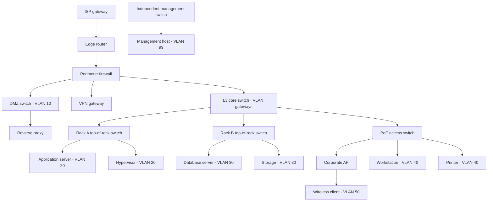

# Reference site topology

NEXUS models a small enterprise data center with an attached office. The inventory has 20 assets and 18 directed service dependencies. It demonstrates realistic device roles and security-zone boundaries; it does not configure or emulate network hardware.

| Zone | Addressing and role |
| --- | --- |
| WAN | `203.0.113.1` is a documentation-only provider address |
| Edge / Core | `10.255.*` management and transit addresses; the L3 core represents internal SVI/default gateways |
| DMZ | VLAN 10, `10.10.10.0/24`, public reverse proxy separated by the firewall |
| Data center | VLAN 20, `10.20.0.0/24`, application/virtualization; VLAN 30, `10.30.0.0/24`, private database/storage |
| LAN | VLAN 40, `10.40.0.0/24`, wired clients and printer |
| Wireless | VLAN 50, `10.50.0.0/24`, corporate wireless clients; AP management uses `10.255.40.10` |
| Management | VLAN 99, `10.99.0.0/24`, independent management switch and jump host |

Addresses, VLANs, and device roles describe a reference deployment. VLAN enforcement, firewall policy, routing protocols, NAT, SSIDs, and actual management interfaces must be configured on real equipment separately. The demo does not discover or contact these addresses.

## Inventory and compatibility

`network/topology.json` is the shared reference inventory consumed by both Python and TypeScript. The running editable snapshot defaults to `<repository>/.nexus-data/inventory.json`. Set the same absolute `NEXUS_INVENTORY_FILE` in both processes to use another location. Both services must see the same file and have appropriate filesystem access; in separate containers mount a shared volume at that path. This file store is intended for a single local development deployment, not concurrent multi-instance administration.

Authenticated users read inventory through the Next.js API. Only administrators add devices, add dependencies between existing devices, or remove custom devices. Duplicate IDs/edges, missing endpoints, self-links, and cycles are rejected. Reference assets are protected on the server because scenarios depend on them. The live demo feed reads the active inventory instead of a fixed device list.

On the next backend inventory read or event submission, device IDs/names are upserted into PostgreSQL. The correlation engine reads dependencies from the same snapshot as the UI, rather than the old separately managed `device_dependencies` table. Removed devices remain in PostgreSQL so historical event joins stay intact, but new events for devices outside the current inventory are rejected. The dedicated `nexus_test` database continues to use its SQL dependency fixtures so tests are isolated from live inventory.

The old frontend-local `frontend/.nexus-data/inventory.json` is preserved. On first initialization, the exact bundled four-router demo is upgraded; customized inventories are copied without replacement. `dev-001` through `dev-004` now identify edge router, perimeter firewall, core switch, and office access switch respectively. Existing event IDs remain valid, with names reflecting the updated inventory. Scenario execution checks device membership and reports missing reference assets for custom inventories.

## Impact semantics and redundancy

An arrow means a downstream service may depend on the upstream asset. Breadth-first traversal reports the shortest hop depth. A failed AP scopes its wireless client, not wired hosts. A firewall failure scopes both DMZ and internal branches; the independent management network remains outside that branch.

Potential impact is not proof that a downstream device is down. A WAN outage may interrupt internet access while local east-west traffic continues. Observed impact requires event evidence. Shared ancestors alone do not prove an upstream device failed.

Production sites usually add dual ISP circuits, routers, HA firewalls, core pairs, and dual-homed racks. This reference uses one logical device per role. Multiple dependency paths can be represented, but the engine does not model active/standby state, ECMP, link aggregation, or successful failover; it cannot decide whether surviving paths keep a service reachable. Do not interpret the diagram as a complete physical cabling map or a production HA design.

## Run and validate

Use Node.js 20.9+ (Node 24 tested), Python 3.11+ (Python 3.12 tested), and PostgreSQL (17 tested).

1. Create local `nexus` and `nexus_test` PostgreSQL databases. Initialize each with `psql "$DATABASE_URL" -v ON_ERROR_STOP=1 -f backend/schema.sql`, using the corresponding URL. The schema is additive and keeps existing data; back up a production database before applying schema changes.
2. From `backend`, create/activate a virtual environment and run `pip install -r requirements.txt`. Set `DATABASE_URL` to the development database and run `uvicorn main:app --reload --host 127.0.0.1 --port 8000`.
3. From `frontend`, run `npm ci`, then `npm run dev`. Open the console, create an account (the first account is the local administrator), and inspect Topology and Network Inventory.
4. Run a firewall, rack, AP, or management scenario. Confirm the incident root and downstream scope, then inspect the topology's incident selector and asset details.
5. From `backend`, run `DATABASE_URL=postgresql://.../nexus_test python -m pytest -q`. From `frontend`, run `npm test -- --run`, `npx tsc --noEmit`, and `npm run build`. The build needs HTTPS access to `fonts.googleapis.com` and `fonts.gstatic.com`.

The existing frontend auth still uses local file storage and a development session-secret fallback. Set a private `NEXUS_SESSION_SECRET` for deployment. The FastAPI service is an internal API; keep it on a trusted network. This change does not add production backend authorization or a production deployment stack.
